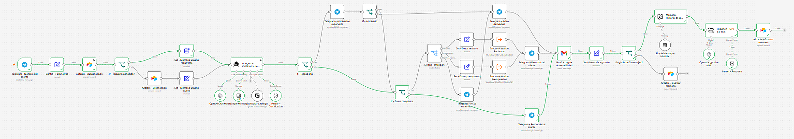
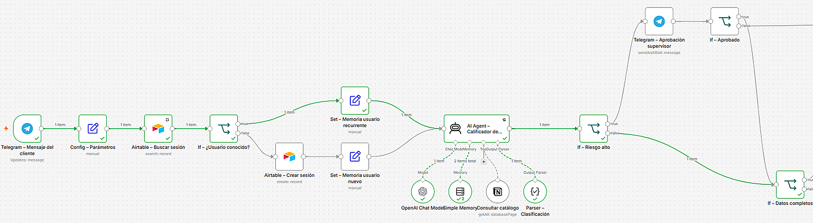
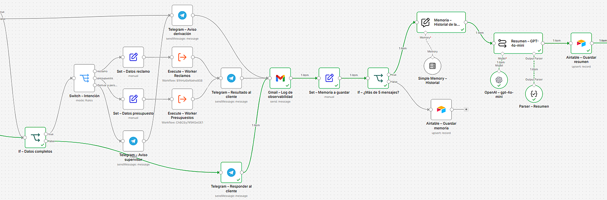
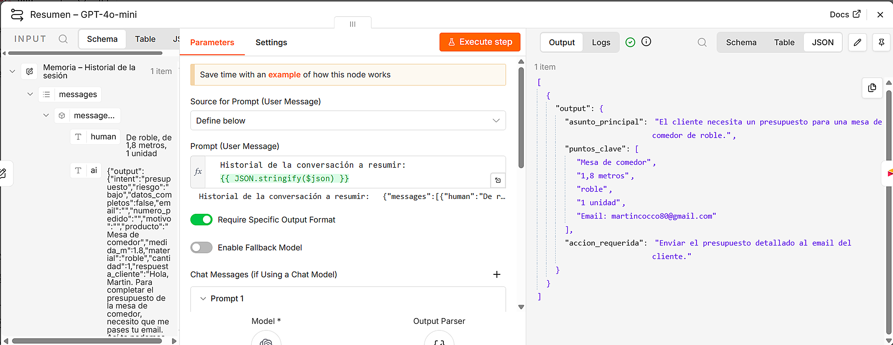
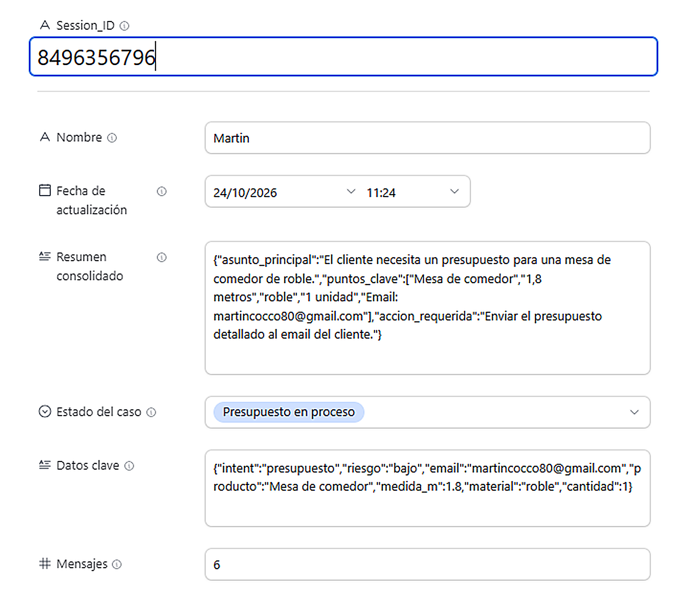
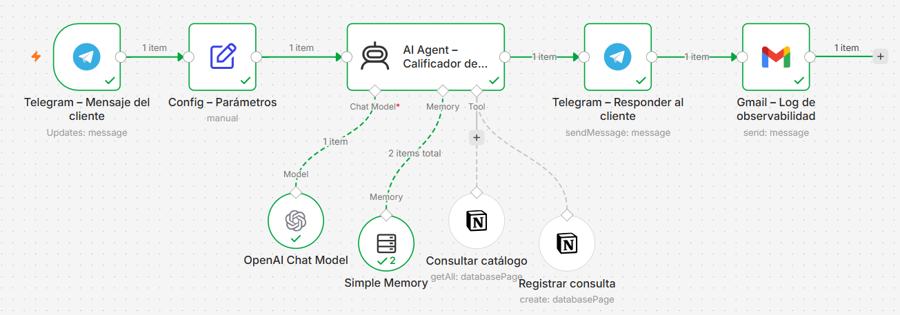
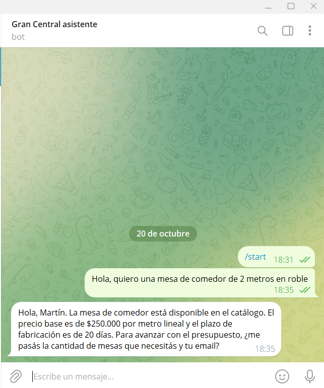
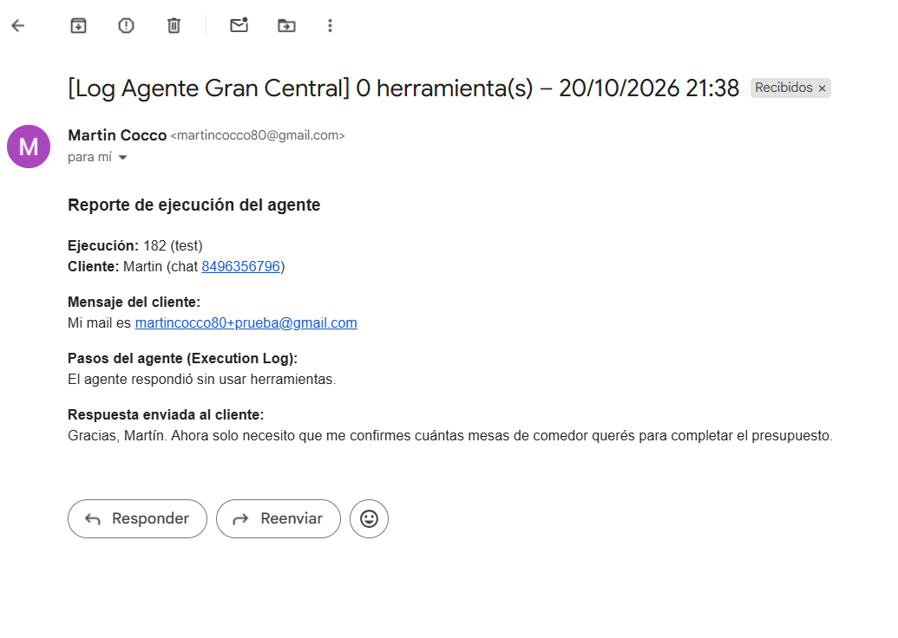

# Gran Central: agente integrador en n8n

Proyecto integrador del curso Automatización Avanzada (Coderhouse). Es un agente de atención para la mueblería ficticia Gran Central que recibe consultas por Telegram, consulta el catálogo en Notion, deriva presupuestos y reclamos a sus Workers y recuerda a cada cliente entre una charla y otra con una memoria en Airtable.

El proyecto crece módulo a módulo, así que cada checkpoint se arma sobre el mismo workflow.

## Contenido del repositorio

| Archivo | Qué es |
|---|---|
| `checkpoint1_martin_cocco.json` | Workflow del Checkpoint 1 (agente base) |
| `checkpoint3_martin_cocco.json` | Workflow principal actual (Manager con memoria persistente) |
| `worker_reclamos.json` | Sub workflow que registra los reclamos en Notion |
| `worker_presupuestos.json` | Sub workflow que calcula el presupuesto y redacta el borrador con IA |
| `checkpoint3/` | Capturas y PDF de entrega del Checkpoint 3 |
| `flujo.png`, `telegram.png`, `log.png` | Capturas del Checkpoint 1 |

## Checkpoint 3: memoria persistente y resumen

Al workflow del Módulo 2 (Manager con Workers) le sumamos una memoria de largo plazo en Airtable. Cada cliente se identifica con un Session_ID (el chat.id de Telegram) y con esa clave se lee y se escribe su fila, así nunca se mezclan los datos de dos usuarios.

Acá vemos el flujo completo ejecutado, con la rama de resumen recorrida.

Acá vemos la lectura de la memoria: busca la sesión en Airtable y separa al usuario conocido del usuario nuevo antes de llegar al agente.

Acá vemos las rutas del agente, el guardado de la memoria y la rama que se activa cuando la charla supera los 5 mensajes.

Acá vemos el resumen que genera GPT-4o-mini, siempre con el mismo formato JSON (asunto_principal, puntos_clave y accion_requerida).

Acá vemos la fila de la sesión en Airtable después de la prueba de 6 mensajes.

El documento completo de la entrega está en [PreEntrega_Modulo3_MartinCocco.pdf](checkpoint3/PreEntrega_Modulo3_MartinCocco.pdf).

## Checkpoint 1: agente base

Agente de calificación de consultas que recibe mensajes por Telegram, consulta el catálogo y registra las consultas en Notion, con un log de cada ejecución por Gmail.

Acá vemos el flujo completo ejecutado en verde.

Acá vemos la conversación con el bot en Telegram.

Acá vemos el mail de log con los pasos que hizo el agente.

## Cómo importar los workflows

1. En n8n, creá un workflow nuevo y desde el menú de los tres puntos elegí **Import from File**. Importá primero `worker_reclamos.json` y `worker_presupuestos.json`, y guardalos (los dos tienen que quedar publicados para que el Manager los pueda llamar).
2. Importá `checkpoint3_martin_cocco.json` en otro workflow nuevo.
3. En los nodos `Execute – Worker Reclamos` y `Execute – Worker Presupuestos`, volvé a elegir los Workers que importaste (n8n les asigna un ID nuevo al importarlos).
4. Cargá las credenciales de la tabla de abajo y seleccionalas en cada nodo que las use.
5. En `Config – Parámetros` cambiá `email_log` por tu mail y `chat_supervisor` por el chat.id de Telegram de quien aprueba los casos de riesgo alto.
6. Armá la base de Airtable y las bases de Notion como se describe más abajo, y elegilas en los nodos de Airtable y Notion.
7. Tocá **Execute workflow** y escribile al bot de Telegram para probarlo.

## Credenciales necesarias

| Servicio | Tipo de credencial | Dónde se usa |
|---|---|---|
| Telegram | Bot token (se crea con @BotFather) | Trigger, respuestas al cliente y aprobación del supervisor |
| OpenAI | API key (o los créditos gratis de n8n) | Agente principal (gpt-4o) y resumen (gpt-4o-mini) |
| Groq | API key | Redacción del borrador en el Worker de Presupuestos |
| Notion | OAuth2 | Catálogo, materiales, pedidos, reclamos y presupuestos |
| Gmail | OAuth2 | Log de observabilidad de cada ejecución |
| Airtable | Personal Access Token (permisos `data.records:read`, `data.records:write` y `schema.bases:read`, con acceso a la base) | Lectura y escritura de la memoria |

Ningún JSON incluye claves ni tokens: al importarlos, cada nodo pide elegir la credencial propia.

## Bases de datos

**Airtable (base Gran Central – Memoria, tabla Sesiones)**

| Campo | Tipo |
|---|---|
| Session_ID | Texto de una línea (campo principal) |
| Nombre | Texto de una línea |
| Fecha de actualización | Fecha y hora |
| Resumen consolidado | Texto largo |
| Estado del caso | Selección única (Nuevo, Esperando datos, Presupuesto en proceso, Reclamo registrado, Derivado a asesor) |
| Datos clave | Texto largo |
| Mensajes | Número entero |

**Notion:** Catálogo, Materiales, Pedidos, Reclamos y Presupuestos (las propiedades que usa cada nodo se ven en su configuración dentro del JSON).
